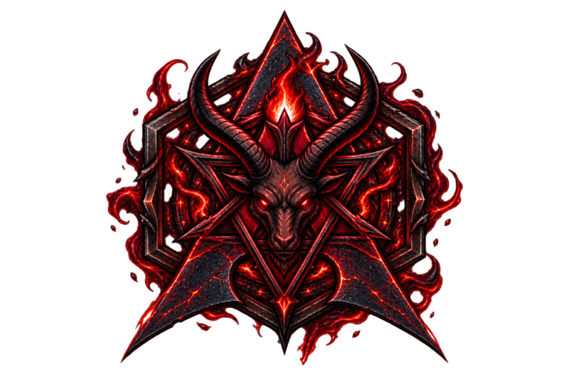

## What it is

- Base: EndeavourOS, no desktop environment. Calamares online install, pick No Desktop.
- Shell: Omarchy shell, forked and renamed to Hexciri. Menu, bar, themes, plugin support, all of it.
- Pinned Omarchy source: `omacom/omarchy`, branch `quattro`, commit `94a8c3c3321129fae87a329947711355897e69fd`.
- Compositor: Hyprland only (Lua config, 0.57 is Lua only). Quickshell only. No Niri, no Noctalia.
- Boot: systemd-boot, ext4. No GRUB, no btrfs, no snapshots, no Limine, no Plymouth.
- Login: SDDM, like Omarchy.
- End goal: almost nothing installed, still feels like Omarchy.

## Install

Fresh EndeavourOS no-DE install, then run as a normal user, from tty3 if you can:

```bash
curl -LO https://hexciri.dirty.pizza/v2/bootstrap.sh
bash bootstrap.sh
```

That downloads the `nyx` branch, verifies it, and runs `v2/install.sh`. It does everything up to reboot, then you reboot and pick Hexciri at SDDM. Fallback, raw GitHub:

```bash
curl -LO https://raw.githubusercontent.com/Deoxizn/hexciri/nyx/v2/bootstrap.sh
bash bootstrap.sh
```

Do not pipe curl into bash, stdin stays on the terminal that way. No git auth needed.

## Update

```bash
hexciri update
```

That is the normal path now. It runs system packages (pacman, AUR via yay, mise), then Hexciri self-update (git sync of `nyx`, tarball fallback), then re-applies the installer only when something in it changed. Patch-only changes use a short re-apply, not a full installer run. First update after a system-range change is full by design, then it goes quiet again. Bootstrap is fallback only.

## Keybinds

`Mod` is Super.

| Keys | Do |
|---|---|
| `Mod+Space` | Apps |
| `Mod+Alt+Space` | Menu |
| `Mod+Ctrl+S` | Hexciri Settings |
| `Mod+Ctrl+Shift+S` | Share |
| `Mod+Shift+S` | Web search |
| `Mod+Shift+C` | Calculator |
| `Mod+Shift+M` | Spotify |
| `Mod+Shift+T` | System monitor (`btm`) |
| `Mod+K` | Keybinds cheatsheet |
| `Mod+Q` | Close window |
| `Mod+Return` | Terminal |
| `Mod+Shift+F` | Files |

Full list: `Mod+K`, or Learn in the menu.

## Defaults

| Thing | Default |
|---|---|
| Terminal | Kitty |
| File manager | Strata |
| Browser | Brave Origin |
| Editor | Zed |
| Image viewer | imv |
| PDF reader | zathura |
| System monitor | bottom (`btm`) |
| Font | JetBrainsMono Nerd Font, Maple Mono NF installed, Maple Mono NF CN selectable |
| Dock | Strata, Spotify, Brave Origin, Zed, Kitty |

## Themes

```bash
hexciri-theme set <name>
hexciri-theme list
hexciri theme sync
```

23 stock themes ship. Theme format stays Omarchy compatible, so Omarchy themes load. One theme pick recolors terminal, editor, browser, bar, lock screen, file manager, and login screen.

Theme hooks live in `~/.config/hexciri/hooks/theme-set.d/`. Hexciri adds its own: GTK/signals, Adapta (opt-in), THPM, plus custom Lua binds/apps. Extra themes, bulk add/remove:

```bash
# one git URL per line, # comments
~/.config/hexciri/themes.list
hexciri theme sync
```

Trusted themes can also be linked with `hexciri theme link <git-url>`, which restores theme Lua that Omarchy 4.0.1 blocks.

## Settings

Hexciri Settings is a shell plugin, not a bar widget. `Mod+Ctrl+S`, or the launcher icon. 23 panes, no channel, no Herdr. It is installed and built automatically by `hexciri update`, no manual build. Source: `Deoxizn/hexciri-settings`, plugin id `pizza.dirty.settings`.

Display HDR/VRR lives in the Display tab, Advanced group (collapsed).

## Plugins

Works with default Omarchy plugins. Some forking/tweaking may be needed to hexciri them.

## Sources

[Omarchy](https://github.com/omacom/omarchy) x [EndeavourOS](https://endeavouros.com) x [Hyprland](https://hyprland.org) x [Quickshell](https://quickshell.org) x [THPM](https://github.com/OldJobobo/thpm) x [theme-link](https://github.com/ministry-of-taste/theme-link)
